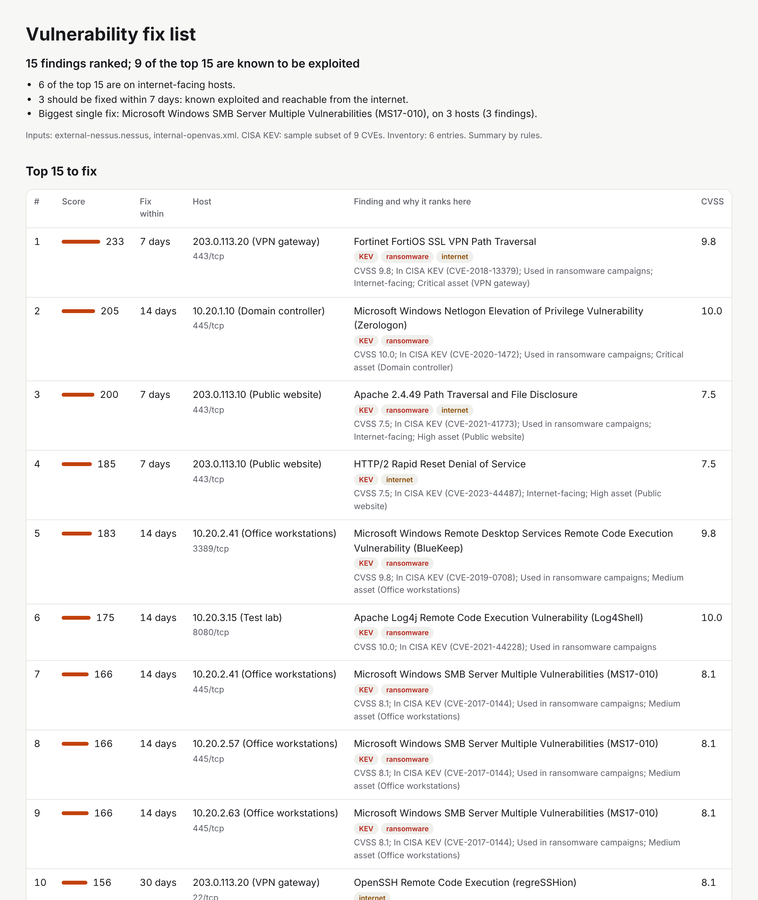

# Vulnerability report prioritizer

[](https://github.com/arafathossein/vuln-report-prioritizer/actions/workflows/tests.yml)

**Turn a 2,000-line scan report into the 20 things to fix this week.** Feed it OpenVAS / Greenbone or Nessus results, an asset list and the CISA Known Exploited Vulnerabilities catalog. It ranks every finding by real-world risk, explains each score in plain words, suggests a fix-by date, and groups findings that a single fix clears across many hosts.

It reads report files only. It never scans, logs in or changes anything.

Built by [AFYRA Technologies](https://afyra-iota.vercel.app). Part of a small set of open tools with [firewall-rule-auditor](https://github.com/arafathossein/firewall-rule-auditor) and [network-config-drift-detector](https://github.com/arafathossein/network-config-drift-detector).



*Rendered from the bundled sample scans with `vulnprio demo`. Hosts, names and addresses are fictional; the KEV entries are real.*

## Why

Scanners sort by CVSS. CVSS measures how bad a flaw could be, not how likely it is to be used against you. Most teams end up with hundreds of "critical" findings and no clear order, so the ones attackers actually use sit in the same pile as the theoretical ones.

Three facts change the order far more than CVSS does:

1. **Is it being exploited?** CISA's KEV catalog lists CVEs with evidence of real-world exploitation.
2. **Can the internet reach it?** The same flaw is far more urgent on the VPN gateway than on a lab box.
3. **What does the host do?** The domain controller matters more than a test VM.

This tool combines them with CVSS in a score anyone can check.

## How the score works

Every point is shown next to the finding, so a security lead can agree or argue:

| Signal | Points |
| --- | --- |
| CVSS base score | × 10 (0–100) |
| CVE is in CISA KEV | +60 |
| ...and KEV marks it as used in ransomware | +15 |
| Scanner reports a public exploit (only if not in KEV) | +15 |
| Host is internet-facing | +30 |
| Asset criticality | +30 critical, +20 high, +10 medium |
| Host missing from the asset inventory | +10 (unknown is not the same as safe) |

Example from the demo: a FortiOS SSL VPN flaw on the VPN gateway scores 98 (CVSS 9.8) + 60 (KEV) + 15 (ransomware) + 30 (internet) + 30 (critical asset) = **233**, and ranks first.

### Suggested fix-by dates

A starting point for your own policy, not a standard:

| Situation | Fix within |
| --- | --- |
| In KEV and internet-facing | 7 days |
| In KEV | 14 days |
| CVSS 9+ on an internet-facing host | 14 days |
| CVSS 7+ | 30 days |
| Everything else | 90 days |

Weights and deadlines live in `Weights` and `Deadlines` in [`score.py`](src/vulnprio/score.py).

### Fixes that clear several hosts

Findings from the same scanner check are grouped, so "Apply MS17-010 and disable SMBv1" shows up once with all 3 workstations under it. One change ticket, one maintenance window.

## Quick start

```bash
python -m venv .venv && source .venv/bin/activate     # Windows: .venv\Scripts\activate
pip install -e ".[dev]"

vulnprio demo                 # sample OpenVAS + Nessus scans, report in reports/
pytest                        # 33 tests
```

### With your own scans

```bash
vulnprio update-kev           # downloads the current CISA KEV catalog to data/kev.json
vulnprio rank scan.xml perimeter.nessus --assets assets.csv --top 20
```

`update-kev` tries cisa.gov first and falls back to CISA's own GitHub mirror (`cisagov/kev-data`) when cisa.gov is blocked. It refuses to replace a working copy with a catalog that looks truncated. Run it weekly; CISA adds entries most weeks.

Outputs in `reports/`: `fix-list.html` to read, `fix-list.csv` to track in Excel (every finding, with owner and reasons), `fix-list.json` for other tools, `fix-list.md` for a ticket or email.

### Supported inputs

| Scanner | Format | How to export |
| --- | --- | --- |
| OpenVAS / Greenbone | XML report | Report → download → XML |
| OpenVAS / Greenbone | CSV results | Report → download → CSV Results |
| Nessus / Tenable | `.nessus` (v2) | Scan → Export → Nessus |
| Nessus / Tenable | CSV | Scan → Export → CSV |

Mix as many files as you like; the same finding reported twice counts once. XML is parsed with `defusedxml`, so a report crafted to attack the parser (entity expansion, external entities) is refused.

### Asset inventory

A CSV with a header row:

```csv
host,name,criticality,internet_facing,owner
203.0.113.20,VPN gateway,critical,yes,Network team
10.20.1.10,Domain controller,critical,no,IT operations
10.20.2.0/24,Office workstations,medium,no,Service desk
```

`host` can be an IP, a CIDR range or a hostname; the most specific match wins. `criticality` is critical, high, medium or low. Without an inventory the tool still ranks by CVSS and KEV.

### In a pipeline

```bash
vulnprio rank scan.xml --assets assets.csv --fail-on-kev   # exit 2 if anything is in KEV
```

## Optional model summary

The report opens with a short summary built from the ranking. To have a language model write it, point it at any OpenAI-compatible endpoint, including Ollama on your own server:

```bash
export LLM_BASE_URL=http://127.0.0.1:11434/v1 LLM_MODEL=llama3.1:8b
```

Only the top findings, their reasons and the grouped fixes are sent. Internal addresses (10/8, 172.16/12, 192.168/16, loopback, link-local, CGNAT) become `[internal]` unless `MASK_INTERNAL_IPS=false`. If the model fails, the built-in summary is used and the report says so.

## Limits

- The score is a triage aid. It can't see compensating controls, such as a WAF or a host that's already isolated.
- EPSS (exploit prediction scores) is not used yet.
- CVSS comes from the scanner; the tool doesn't look up NVD.

## Project layout

```
src/vulnprio/
  parsers/      openvas.py, nessus.py, csvfmt.py (defusedxml for XML)
  assets.py     inventory loading and IP / CIDR / hostname matching
  kev.py        KEV catalog loading and download with mirror fallback
  score.py      weights, deadlines, ranking, fix grouping
  summary.py    built-in and optional model summary, IP masking
  report.py     HTML, Markdown, CSV, JSON
  cli.py
samples/        fictional scans and inventory, a real 9-entry KEV subset
```

## Roadmap

- EPSS scores as an extra signal
- Compare this week's scan with last week's: fixed, new, overdue
- Jira / ServiceNow ticket export for each grouped fix

## License

MIT, see [LICENSE](LICENSE).
